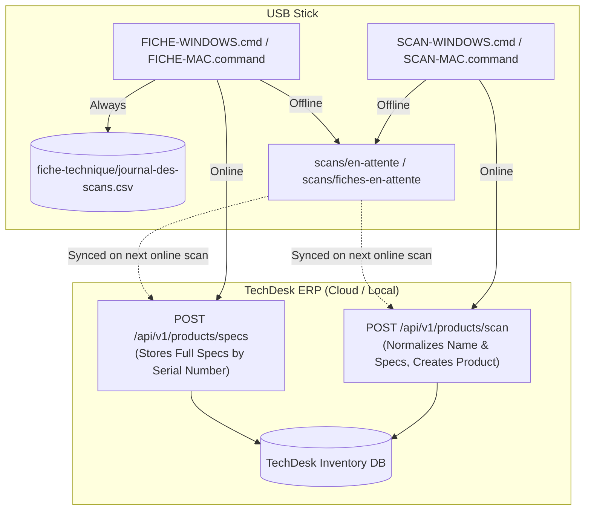

# TechDesk USB Scanner

[](https://github.com/HBL-LL/techdesk-usb-scanner/releases)
[](LICENSE)
[](README.md)

A plug-and-play USB utility that automates laptop intake and hardware inventory for **TechDesk ERP**. Plug the stick into any incoming laptop (Windows or Mac), run one command, and the laptop is instantly identified, configured, and registered in stock or documented with a detailed technical sheet (*fiche technique*).

Instructions for shop staff (in French) are provided in [LISEZ-MOI.txt](LISEZ-MOI.txt) at the root of the stick.

---

## Features

- ⚡ **Instant Stock Intake (`SCAN-*`)**: Reads manufacturer, model, CPU, RAM, storage, GPU, and BIOS/system serial number. Sends the laptop directly to `POST /api/v1/products/scan`. TechDesk normalizes the product name and configuration into the shop's standard format, flagged as **Prix manquant** until pricing is confirmed.
- 📋 **Complete Technical Sheet (`FICHE-*`)**: Deep hardware inspection:
  - **Chassis Color**: Physical housing finish (e.g. `Argent`, `Noir sidéral`, `Gris sidéral`, `Minuit`, `Lumière stellaire`, `Noir`, `Gris`).
  - **Display**: Screen diagonal (calculated from panel mm/EDID, rounded to commercial sizes), native resolution, maximum refresh rate, panel technology (`OLED`, `Liquid Retina XDR`, `mini-LED`, `LCD`), and raw panel model code.
  - **Processor & GPU**: Core layout (performance vs. efficiency cores), dedicated/integrated GPUs, VRAM.
  - **Memory & Storage**: Unified memory / RAM type and speed, internal NVMe/SSD drive capacity.
  - **Battery**: Real-time health percentage (`Full Charge Capacity / Design Capacity` or macOS `Maximum Capacity`) and cycle count.
  - **Logging & ERP Sync**: Writes directly to `fiche-technique/journal-des-scans.csv` (UTF-8 BOM `;`-separated for Excel/Numbers) and pushes specs to TechDesk (`POST /api/v1/products/specs`).
- 🔄 **Offline-First Resilience**: If the laptop or shop Wi-Fi has no connection, scans and fiches are queued locally on the USB stick (`scans/en-attente` and `scans/fiches-en-attente`). They automatically sync to TechDesk the moment any subsequent scan runs with internet access.
- 🪟 **Windows OOBE / Out-of-Box Support**: Scans can run directly during initial Windows setup (Shift+F10 command prompt), keeping new laptops 100% factory-sealed without creating a local user account.
- 🍎 **Zero-Dependency macOS Script**: Uses only native macOS utilities (`system_profiler`, `sysctl`, `diskutil`, `plutil`, `ioreg`, `osascript`). No Homebrew, Python, or external packages required.
- 🔒 **Restricted Security Scope**: Uses a dedicated **USB scanner** API key (`smk_…`) that can only add new products and specs. It cannot read existing inventory, view financial metrics, or alter prices. If a stick is lost, its key can be instantly revoked from TechDesk.

---

## USB Stick File Structure

```text
USB Stick (exFAT)
├── SCAN-WINDOWS.cmd               # Quick stock intake for Windows (double-click or Shift+F10)
├── SCAN-MAC.command               # Quick stock intake for macOS (double-click)
├── LISEZ-MOI.txt                  # French instructions for workshop staff
├── settings.txt                   # TechDesk URL and API key configuration
│
├── scanner/                       # Stock intake engine
│   ├── scan-windows.ps1           # Windows PowerShell 5.1 intake script
│   └── scan-mac.sh                # macOS bash 3.2 intake script
│
├── fiche-technique/               # Full technical specification engine
│   ├── FICHE-WINDOWS.cmd          # Spec intake launcher for Windows
│   ├── FICHE-MAC.command          # Spec intake launcher for macOS
│   ├── journal-des-scans.csv      # Local CSV log (created on first run)
│   └── outils/
│       ├── fiche-windows.ps1      # PowerShell EDID/CIM spec extractor
│       └── fiche-mac.sh           # macOS native spec extractor
│
└── scans/                         # Created at runtime for queue management
    ├── en-attente/                # Stock scans pending upload
    ├── envoyes/                   # Successfully uploaded stock scans
    ├── fiches-en-attente/         # Spec sheets pending upload
    └── fiches-envoyees/           # Successfully uploaded spec sheets
```

---

## Setup Guide

### 1. Prepare the USB Stick (Once)

1. Format a USB drive as **exFAT** (ensures read/write compatibility across both Windows and macOS):
   - **Mac**: Disk Utility → Select USB drive → **Erase** → Format: **ExFAT**, Scheme: **Master Boot Record**.
   - **Windows**: Right-click USB drive in File Explorer → **Format...** → File system: **exFAT**.
2. Download the latest release package from [Releases](https://github.com/HBL-LL/techdesk-usb-scanner/releases) and extract all files to the root of the USB drive (or copy repository contents omitting `.git*` and `README.md`).
3. Generate an API Key in TechDesk:
   - Navigate to **Settings → API**.
   - Enable **USB scanner (adds laptops only)**.
   - Name the key (e.g. `Clé USB Atelier`) and click **Create key**.
   - Copy the generated key (`smk_...`).
4. Configure `settings.txt` on the USB drive:
   ```ini
   TECHDESK_URL=https://your-techdesk-instance.com
   API_KEY=smk_your_secret_key_here
   ```
   > [!IMPORTANT]
   > Do not include a trailing slash in `TECHDESK_URL`. Keep this file and key confidential; never commit production keys to git.

---

## Usage Workflows

### Workflow A: Adding a Laptop to Stock (`SCAN-*`)

#### On Windows:
- **Brand new laptop on Windows OOBE setup screen** (Region/Wi-Fi selection):
  1. Plug in the USB stick.
  2. Press <kbd>Shift</kbd> + <kbd>F10</kbd> (or <kbd>Shift</kbd> + <kbd>Fn</kbd> + <kbd>F10</kbd>). A Command Prompt opens.
  3. Run `D:\SCAN-WINDOWS.cmd` (or try `E:\`, `F:\` depending on drive letter).
  4. Once complete, close the prompt window. The laptop remains brand new in its factory setup state.
- **Configured Windows laptop**: Open the USB drive and double-click `SCAN-WINDOWS.cmd`.

#### On Mac:
1. Plug in the USB stick.
2. Double-click `SCAN-MAC.command` in Finder (if prompted by Gatekeeper, right-click → **Open**).

#### Terminal Feedback:
| Status Message | Meaning & Action |
|---|---|
| `AJOUTÉ AU STOCK` | Successfully added to TechDesk. Bar ID and generated configuration are displayed. |
| `DÉJÀ EN STOCK` | Laptop with this serial number is already in stock. Not duplicated. |
| `Pas de connexion à TechDesk` | No network connection. Saved to `scans/en-attente/` and sent automatically during the next online scan. |
| `TechDesk refuse la clé` | API key invalid or revoked. Check `API_KEY` in `settings.txt`. |
| `Réglages incomplets` | `settings.txt` still contains example placeholders. |

---

### Workflow B: Adding the Full Fiche Technique (`FICHE-*`)

The `fiche-technique` tool extracts comprehensive hardware telemetry and sends it to `POST /api/v1/products/specs`. It can be run before or after the stock intake scan:
- If run **after**: the specs immediately link to the product sheet in TechDesk.
- If run **before**: TechDesk stores the specs by serial number and associates them automatically once the product is scanned into stock.
- Running it again on the same laptop updates its record (e.g., re-evaluating battery condition).

- **Windows**: Double-click `fiche-technique\FICHE-WINDOWS.cmd` (or run `D:\fiche-technique\FICHE-WINDOWS.cmd` via Shift+F10).
- **Mac**: Double-click `fiche-technique/FICHE-MAC.command`.

#### Telemetry Extraction Details

| Specification | Windows Detection (`fiche-windows.ps1`) | macOS Detection (`fiche-mac.sh`) |
|---|---|---|
| **Product Name & SKU** | System manufacturer + normalized model / Lenovo Type Code | Marketing name (`MacBook Pro (14-inch, Nov 2024)`), Apple model number |
| **Serial Number** | BIOS serial number (`Win32_BIOS`) | Hardware system serial number (`SPHardwareDataType`) |
| **Couleur (Color)** | WMI model / SKU pattern matching (e.g. Noir, Gris, Argent, Bleu) | Decoded from IOKit device tree `housing-color` (Argent, Noir sidéral, Gris sidéral, Minuit, Lumière stellaire) + Apple part number catalog |
| **Display Size & Res** | Decoded from EDID Detailed Timing Descriptor (mm converted to diagonal inches) | Measured physical dimensions via `AppKit` / `NSScreen`, matched to Apple diagonal standards |
| **Panel Technology** | Evaluates EDID descriptor strings and CTA-861 HDR black-level luminance (`OLED`, `OLED (probable)`, or `LCD`) | `Liquid Retina XDR (mini-LED)`, `Liquid Retina (LCD)`, or `Retina (LCD)` |
| **Processor** | CPU name, physical core and thread count | Apple Silicon / Intel chip designation with performance + efficiency breakdown |
| **Graphics** | Active GPU adapters and dedicated memory | GPU architecture and integrated core count |
| **RAM** | Total capacity, generation (DDR4, DDR5, LPDDR5), clock speed | Unified memory / system memory type and capacity |
| **Storage** | Total disk capacity, interface type (NVMe, SSD, HDD) | Physical disk size normalized to commercial capacities (e.g. 512 Go, 1 To) |
| **Battery Health** | Full charge vs. design capacity via `powercfg /batteryreport` (WMI fallback) + cycle count | Maximum Capacity percentage, overall condition rating, and cycle count |

---

## Technical Architecture & ERP Integration



1. **Normalized Stock Ingestion**:
   Raw hardware facts (`maker`, `model`, `cpu`, `ramBytes`, `diskBytes`, `gpus`, `serialNumber`) are transmitted to `POST /api/v1/products/scan`. TechDesk server logic formats standard shop titles and config tags dynamically without needing updates on the stick.
2. **Dedicated Spec Storage**:
   `POST /api/v1/products/specs` stores comprehensive display, battery, and component details linked by serial number. Invoices (*factures*) and receipts (*reçus*) draw display and battery summaries directly from this table.

---

## Compatibility & Requirements

- **Operating Systems**:
  - Windows 10 & Windows 11 (including Windows PE / OOBE Shift+F10 console). Compatible with Windows PowerShell 5.1.
  - macOS Catalina (10.15) through macOS Sequoia (15.x+) on both Intel and Apple Silicon (M1/M2/M3/M4) architectures.
- **Filesystem**: exFAT format recommended.
- **TechDesk ERP**: Version supporting `/api/v1/products/scan` and `/api/v1/products/specs`.

---

## Maintenance & Script Guidelines

- **PowerShell compatibility**: `scan-windows.ps1` and `fiche-windows.ps1` must remain compatible with **Windows PowerShell 5.1** (avoid null-coalescing `??` or ternary operators). Save files as **UTF-8 with BOM** and **CRLF** line endings (enforced via `.gitattributes`).
- **macOS bash compatibility**: `scan-mac.sh` and `fiche-mac.sh` must remain compatible with Apple's default `/bin/bash` (**Bash 3.2**). Do not introduce dependencies on Python, Node.js, or external CLI tools.
